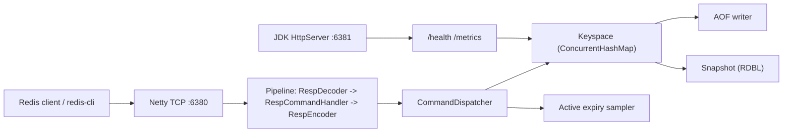

# RespLite

RespLite is a Redis-compatible in-memory cache server written in Java. It speaks the RESP2 wire protocol on TCP port **6380** (by default), so `redis-cli`, Jedis, and Lettuce connect without protocol adapters. Keys support TTL expiry, and durability comes from append-only file (AOF) logging plus periodic binary snapshots—after a kill or crash, data recovers on restart.

## Problem

Redis is often treated as a black box: clients send commands and hope state survives restarts. RespLite is a small, readable implementation that makes the protocol, Netty pipeline, expiry model, and persistence trade-offs explicit while staying compatible with real Redis clients.

## Features

- RESP2 encoder/decoder with fragmented frames, pipelining, and inline commands (`telnet`/`nc` PING)
- Core commands: `PING`, `ECHO`, `GET`, `SET` (EX/PX/NX/XX), `DEL`, `EXISTS`, `INCR`/`DECR`/`INCRBY`, `MGET`, `MSET`, `KEYS`, `DBSIZE`, `FLUSHALL`, `COMMAND`, `QUIT`
- Expiry: `EXPIRE`, `PEXPIRE`, `TTL`, `PTTL`, `PERSIST`, lazy expiry on read, active sampling expiry
- AOF persistence with `always` / `everysec` / `no` fsync; absolute `EXPIREAT` in the log
- Versioned binary snapshots (`RDBL`), `SAVE` / `BGSAVE`, `BGREWRITEAOF`
- `INFO` and HTTP `/health` + `/metrics` on port **6381**
- Benchmark harness and `redis-benchmark` compatibility

## Architecture



## Supported commands

| Command | Notes |
|---------|--------|
| `PING` | Optional message argument |
| `ECHO` | Returns bulk string |
| `GET` / `SET` | `SET` supports EX, PX, NX, XX |
| `DEL` / `EXISTS` | Multi-key |
| `INCR` / `DECR` / `INCRBY` | Integer errors match Redis wording |
| `MGET` / `MSET` | |
| `EXPIRE` / `PEXPIRE` / `TTL` / `PTTL` / `PERSIST` | |
| `KEYS` | Glob `*` and `?` |
| `DBSIZE` | |
| `FLUSHALL` | |
| `SAVE` / `BGSAVE` / `BGREWRITEAOF` | When persistence enabled |
| `INFO` | Server, clients, memory, keyspace, persistence, stats |
| `COMMAND` | Minimal list for `redis-cli` |
| `QUIT` | Closes connection |

## Build and run

**Requirements:** JDK 21, Maven 3.8+

```bash
mvn verify
mvn package
java -jar target/resplite-1.0.0-SNAPSHOT.jar
```

Docker:

```bash
docker compose up --build
```

Default ports: Redis protocol **6380**, HTTP **6381**. Data directory defaults to `./data`.

### Example `redis-cli` session

```text
$ redis-cli -p 6380
127.0.0.1:6380> PING
PONG
127.0.0.1:6380> SET user:1 dumidu EX 120
OK
127.0.0.1:6380> GET user:1
"dumidu"
127.0.0.1:6380> TTL user:1
(integer) 118
127.0.0.1:6380> INCR counter
(integer) 1
# stop the server (Ctrl+C or kill), then restart java -jar ...
127.0.0.1:6380> GET user:1
"dumidu"
127.0.0.1:6380> TTL user:1
(integer) 97
```

Persistence replays the AOF (and optional snapshot) so keys and remaining TTL survive restarts.

## Configuration

| Property / env | Default | Description |
|----------------|---------|-------------|
| `server.port` / `RESPLITE_PORT` | `6380` | RESP TCP port |
| `http.port` / `RESPLITE_HTTP_PORT` | `6381` | Health and metrics |
| `data.dir` / `RESPLITE_DATA_DIR` | `./data` | AOF and snapshot directory |
| `aof.enabled` / `RESPLITE_AOF_ENABLED` | `true` | Enable AOF |
| `aof.fsync` / `RESPLITE_AOF_FSYNC` | `everysec` | `always`, `everysec`, or `no` |
| `snapshot.enabled` | `true` | Enable RDBL snapshots |
| `snapshot.interval.seconds` | `300` | Background save interval |
| CLI `--port`, `--data-dir`, `--aof-fsync`, `--snapshot-interval` | | Override properties |

## Persistence and crash recovery

1. On startup, load `dump.rdb` (if present), then replay `appendonly.aof`.
2. Each write command is appended as a RESP array. Expiry is stored as absolute `EXPIREAT` so TTL continues across restarts.
3. Snapshots are written to a temp file and renamed atomically; a CRC32 covers the payload body.
4. Truncated AOF tails after a crash are skipped with a warning.
5. `BGREWRITEAOF` compacts the AOF from the current keyspace. Graceful shutdown flushes and fsyncs the AOF.

## Expiry

- **Lazy:** `GET` and related reads drop expired keys.
- **Active:** A background task samples random keys every 100ms (configurable) and deletes expired entries.
- Unit and integration tests use an injectable `Clock` for deterministic TTL behavior.

## Concurrency model

The keyspace is a `ConcurrentHashMap`. Netty handles many concurrent connections on shared event loops; `INCR` uses `ConcurrentHashMap.compute` for atomic read-modify-write. This matches a pragmatic middle ground between single-threaded Redis and fully lock-free structures: minimal locking per key for counters, copy-on-restore for snapshots.

## Benchmark results

Measured on this build host: **Linux 6.12.113+ (x86_64), 4 vCPUs**, OpenJDK 21, RespLite with AOF enabled (`everysec`), local loopback.

**`RespLiteBenchmark`** (8 clients, 5,000 SET+GET pairs each, raw RESP pipelining on one connection per client):

| Metric | Value |
|--------|------:|
| Throughput | **68,711** op/s (SET+GET pairs counted as 2 ops) |
| p50 latency | **137** µs |
| p99 latency | **2,296** µs |

```bash
mvn -q exec:java -Dexec.mainClass=dev.dumidu.resplite.benchmark.RespLiteBenchmark \
  -Dexec.args="127.0.0.1 6380 8 5000"
```

**`redis-benchmark`** (10,000 requests per test, `-t set,get`):

| Test | RPS | p50 |
|------|-----|-----|
| SET | **34,247** | 0.639 ms |
| GET | **80,000** | 0.335 ms |

```bash
redis-benchmark -p 6380 -t set,get -n 10000 -q
```

## Project structure

```text
src/main/java/dev/dumidu/resplite/
  protocol/     RESP2 codec
  server/       Netty bootstrap, metrics, HTTP observability
  command/      CommandHandler registry and implementations
  store/        Keyspace, expiry scanner
  persistence/  AOF, snapshots, rewrite
  config/       Properties, env, CLI
  benchmark/    Throughput and latency harness
```

## Testing

```bash
mvn verify
```

Integration tests spin up RespLite on ephemeral ports and use Jedis. The suite includes protocol unit tests, persistence recovery, expiry, observability, and a benchmark smoke test (**40** tests total).

## What I learned

- **Wire protocols:** RESP framing is simple on paper but needs careful partial-buffer handling and inline command support for interactive clients.
- **Netty pipelines:** Decoders should reset reader indices cleanly; one handler per concern keeps backpressure predictable.
- **Durability vs throughput:** `always` fsync is safest; `everysec` is the practical default for cache workloads.
- **Atomic files:** Snapshots and AOF rewrite use write-temp-then-rename to avoid torn reads.
- **Expiry:** Lazy deletion saves CPU; active sampling prevents unbounded dead key growth.
- **Real clients:** Testing with Jedis caught arity and integer error semantics early.

## License

[MIT License](LICENSE). Developed by Dumidu Lakshan.